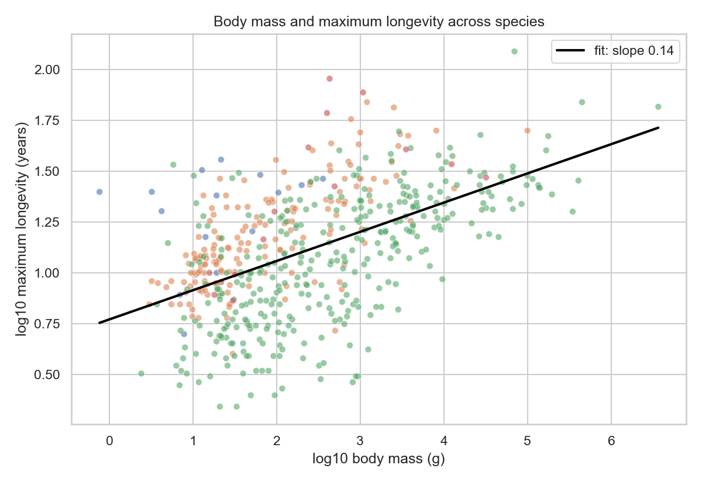

# Does body mass explain how long an animal lives?

A small data analysis project looking at the relationship between body mass and maximum longevity
across animal species.



## Problem / research question

Larger animals are often said to live longer. This project asks two questions:

1. How strongly does body mass explain maximum longevity across species?
2. Does the relationship hold equally for mammals and birds?

## Dataset source and usage permissions

- **Source:** AnAge database, Human Ageing Genomic Resources (HAGR), <https://genomics.senescence.info/species/>.
- **File:** `data/anage_data.csv`, one row per species (4218 rows, 30 columns).
- **Usage:** AnAge is published for academic and non-commercial research use; the course materials
  distribute this CSV for teaching. No personal data and no restricted data are included in this
  repository. If you reuse the data, cite the AnAge database.

## Methods and tools used

- Python 3 with pandas and NumPy for loading and cleaning.
- Cleaning: keep species with a reported body mass and maximum longevity, drop non-positive values,
  and take log10 of both variables (both span several orders of magnitude).
- Exploratory statistics: Pearson correlation and an ordinary least-squares line on the log-log scale,
  fitted with `numpy.polyfit`; R2 computed from the residual and total sums of squares.
- Visualization: Matplotlib and seaborn, saved as PNG files in `figures/`.

## Key findings and one limitation

- Positive but loose relationship: r = 0.53, R2 = 0.28 over 546 species. Body mass is a real predictor
  but leaves most variation unexplained.
- Shallow slope: the log-log slope is 0.143, so a ten-fold increase in mass corresponds to only about a
  1.39-fold increase in maximum longevity.
- Birds and mammals have similar slopes (0.183 and 0.207) but different levels: at 100 g the fitted
  longevity is about 8.7 years for a mammal and about 16.2 years for a bird.
- **Limitation:** maximum longevity is a record value rather than an average lifespan, so it depends on
  observation effort, and 3591 of the 4218 source rows do not report body mass, which leaves 546 usable
  species. The analysis is observational and does not establish causation.

## Instructions for running the analysis

```bash
# 1. clone and enter the repository
git clone https://github.com/Olson-Yu/data-science-project.git
cd data-science-project

# 2. install dependencies
pip install -r requirements.txt

# 3. run the notebook (it writes the figures into figures/)
jupyter notebook analysis.ipynb
```

Run the cells from top to bottom. The notebook reads `data/anage_data.csv` with a relative path, so it
must be started from the repository root.

## Repository layout

```
data-science-project/
├── analysis.ipynb                          # the full analysis, executed with outputs
├── data/anage_data.csv                     # source data
├── figures/fig1_mass_vs_longevity.png      # all species, with the fitted line
├── figures/fig2_mammals_vs_birds.png       # mammals vs birds
├── requirements.txt
└── README.md
```

## Author

YU SIRAN (MC635717), Master of Data Science, University of Macau.
